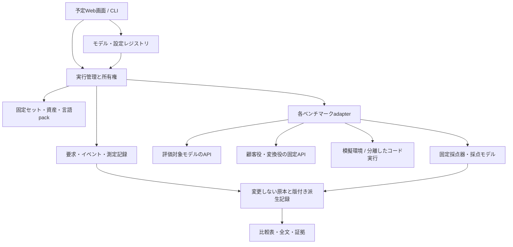

# 04 構成とアダプター契約

## 共通化する層

BeaconBenchは実行管理・条件固定・計測・保存・レポートを共通化する。各上流の採点器や模擬環境は、独立した環境のadapterとして接続する。推論エンジンの内部をBeaconBenchで再実装しない。



## 予定する配置

| パス | 責務 |
|---|---|
| `catalog/` | 候補、出典、能力タグ、採用条件 |
| `suites/` | Quick / Detailed / 互換セットの版付きmanifest |
| `protocols/` | 共通サンプリング、実エンジン上限、終了規則、cache方針 |
| `execution/` | セットと独立した試行回数・seed・集計方針の参照設定 |
| `ui/prototype/` | 通信・実行を伴わない画面試作。正式UIの設計確認用 |
| `schemas/` | case・run・実行設定・測定・判定・翻訳のJSON契約 |
| `src/beaconbench/`（予定） | 実行管理、model transport、記録、再開、統計、レポート |
| `adapters/`（予定） | 上流のtask / environment / grader接続 |
| `local/`（非公開） | endpoint・credential参照・host設定 |
| `.beaconbench/assets/`（非公開） | hashを検証した外部資産 |
| `runs/`（非公開） | 原回答・イベント・判定・レポート |

プロセス起動、Docker、SSH、remote executorは実行管理側へ置く。問題adapterに個別ホストのパス・IP・認証を埋め込まない。学習済みモデルや過去の回答をコードtreeへ混ぜない。

## 契約

以下は予定インターフェース。まだ実装はない。

| 操作 | 入力 | 出力・制約 |
|---|---|---|
| `enumerate_cases` | source lock、条件 | 安定した元task IDと属性。生成や採点をしない |
| `prepare_case` | case、言語pack | 公開観測、非公開grader資産、environment specを分離 |
| `preflight` | resolved protocol、model、executor | capability、hash、接続・資源・helperの検証結果 |
| `reset_environment` | case、trial seed | 同じ初期状態。resetの証拠を記録 |
| `run_trial` | case、model transport、observer | 原要求・回答・操作・最終状態・termination |
| `grade_trial` | 変更しないtrial、grader lock | 原判定、得点、証拠、エラー。対象モデルを呼ばない |
| `summarize` | 判定集合 | 各公式metricと分母。未実行を補完しない |

adapterはすべてのモデル呼び出しを計測付きtransportへ通す。上流が独自HTTP clientを使う場合はrequest/response hookまたは測定proxyで捕捉する。捕捉できない内部呼び出しがある場合は測定coverageを明示し、総消費が完全と表示しない。

モデル、顧客役、採点役、変換役、言語判定役は `role` で識別する。未知のroleを評価対象へ足さない。複数のhelperが必要なnative harnessも役割ごとに固定できる契約にする。

## モデル接続

初版はOpenAI互換Chat Completionsを対象にし、SSEと最終usageを保存する。`base_url`は環境設定、鍵は環境変数の名前で参照する。実行記録へ鍵の値を出さない。

capability negotiationでは、streaming、usage、reasoning、tool calls、seed、sampling、template、context/output上限を確認する。未知のオプションを黙って捨てない。非対応なら `unsupported`、有効設定を確認できなければ `unverified` として、その状態を比較表に表示する。

backend固有の設定を小さいbridgeへ置く。vLLM、llama.cpp等で共通の意味を持たない設定はそのまま個別値として保存する。思考の `xhigh` 等のラベルが他モデルで同じ計算量を表すと仮定しない。

モデル接続、エンジン起動設定、生成設定を分けて名前付きの版として登録する。画面で選択した組み合わせを共通のresolverへ渡し、CLIと同じ実要求・fingerprintを作る。画面だけが別の既定値を持たない。詳細は [画面と設定切替](10-interface-and-configuration.md) を参照する。

## 状態遷移

```text
draft → assets_verified → language_verified → frozen
frozen → preflight → ready → generating/interacting → generated
generated → scoring → scored → reporting → finalized
```

各段階から `unsupported / interrupted / infrastructure_error / invalid_instrument` へ移れる。復帰処理の成否はrun状態とは独立した `restoration_status` として残す。モデル生成完了と採点完了を同じ状態にしない。

イベントはappend-onlyのJSONLで保存し、進捗snapshotはatomic replaceする。snapshotだけから完了を判定せず、成果物SHAと完了markerを照合する。表示側はevent offsetまたはsnapshotを読み、回答全体を毎回メモリに抱えない。

## 予定CLI

以下はコマンド契約案で、現時点では実行できない。

```text
beaconbench catalog
beaconbench assets fetch <lock>
beaconbench language verify <pack>
beaconbench suite freeze <draft>
beaconbench plan --suite <frozen> --model <config> --trials-per-case 1
beaconbench run --plan <resolved-plan>
beaconbench status <run>
beaconbench resume <run>
beaconbench score <run> --grader <lock>
beaconbench compare <run-a> <run-b>
beaconbench report <run>
beaconbench export <run> --policy <public-export-policy>
```

`catalog / plan / status / report` は対象モデルを呼ばない。`assets fetch` 以外のコマンドが不足資産を勝手にダウンロードしない。`plan` が実要求、呼び出す役割、資源配置、native終了条件、未確認事項を展開してから、明示的な `run` で実行する。

## レポート

概要は構成・版・品質・消費・課題時間・完了数を表示。caseごとに原文と日本語、最終回答全文、思考の保存有無、操作・最終状態、各採点根拠へ辿れる。思考を返さないモデルへ思考の開示を要求しない。

全回答を最初に一括ロードしない。case単位で遅延表示し、進捗は手動更新または短いpollで更新する。既定の公開先は作らず、ローカルの静的HTMLを基本にする。画像・回答HTML・ツール出力はエスケープし、生成内容をそのままscriptとして実行しない。
