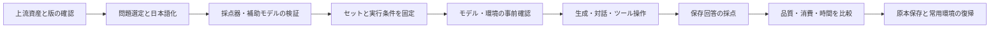

# BeaconBench 詳細設計 v0.1

作成日：2026-10-28。状態：設計案。現在の成果は公開リポジトリと設計契約であり、評価器・翻訳・問題選定の完成を表さない。

## 読み方

| 文書 | 責務 |
|---|---|
| [01 要件](01-requirements.md) | 目的、合意事項、比較単位、対象範囲 |
| [02 候補一覧](02-benchmark-catalog.md) | 分野との対応、出典、実装・日本語・環境上の採用条件 |
| [03 セットと統計](03-suites-and-statistics.md) | Quick / Detailed、問題選定、反復、集計と限界 |
| [04 構成](04-architecture.md) | 共通実行管理、モデル接続、アダプター、予定CLIと契約 |
| [05 プロトコル・指標](05-protocol-and-metrics.md) | 条件一致、トークン・時間・速度・終了理由の定義 |
| [06 日本語化](06-japanese-adaptation.md) | 翻訳範囲、検証、顧客役・採点器の較正 |
| [07 実行](07-execution.md) | 計算ホスト、コード実行の分離、リソース所有、復帰 |
| [08 再現性](08-reproducibility.md) | 保存形式、同一性、再利用、再採点、公開用出力 |
| [09 実装計画](09-implementation-plan.md) | 段階ごとの成果物・受入条件・着手順序 |
| [判断記録](decisions.md) | 合意と提案の区別、根拠、未決事項 |

関連する機械可読設計： [catalog](../catalog/benchmarks.json)、[Quick](../suites/quick.v0.draft.json)、[Detailed](../suites/detailed.v0.draft.json)、[protocol](../protocols/common-ja.v0.draft.json)、[schemas](../schemas/README.md)。

## 全体の流れ

対話中に必要な顧客役は生成段階で動く。後処理の採点器とは別の計算資源・エンドポイントを割り当てる。単発のコード生成は全生成後に対象モデルを解放して採点できる。

## 設計を固定する境界

- 本文中の「必須」はユーザーの合意または比較を成立させる契約を示す。
- 「初版案」「候補」は設計上の提案。問題ID、翻訳、実行環境、補助モデルは受入確認後に固定する。
- 候補・翻訳の準備不足を、問題の成功・失敗や0点に換算しない。
- ソースの最新変更を既存の評価セットへ自動適用しない。異なる版は別の比較系列にする。
